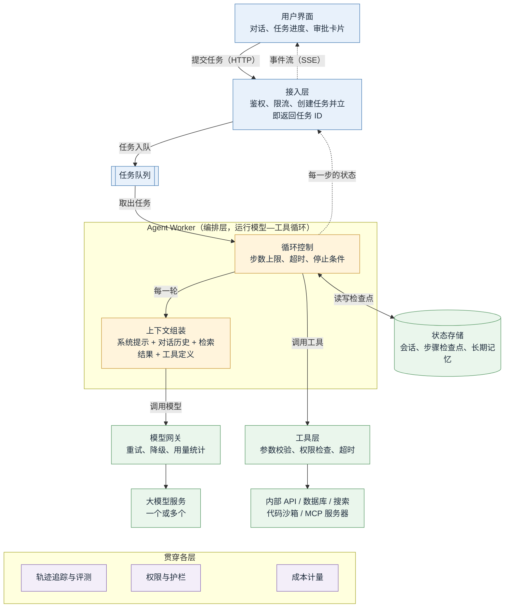

# Web Application 设计思路学习指南（研一工科生版）

> **定位**：这份指南训练的不是"会不会写代码"，而是"**能不能把一个问题想清楚，并设计出一个站得住的 Web 应用系统**"。
> **对象**：研究生一年级、工科背景，有编程与数学建模基础，Web 经验为零或很少。
> **产出目标**：20 周内积累一套可评审的设计作品集 —— 需求分析 → 信息架构 → 数据模型 → 接口契约 → 系统架构 → 非功能设计 → 设计文档，并配一个最小实现作为"设计可落地"的证据。

---

## 一、先明确：Web 应用设计的六个层面

很多人把"设计"等同于画界面，或者等同于选框架。真正的设计发生在六个层次上，越往下改起来越贵：

| 层次 | 要回答的问题 | 典型产出物 | 出错代价 |
|---|---|---|---|
| 1. 问题与用户 | 谁在什么场景下用它？不做会怎样？ | 用户画像、场景故事、需求清单 | 方向性返工 |
| 2. 信息与交互 | 用户按什么顺序完成任务？信息怎么组织？ | 任务流程图、信息架构图、线框图 | 大改交互 |
| 3. 数据与接口 | 系统里有哪些"东西"？它们怎么被读写？ | 领域模型、ER 图、状态机、OpenAPI 契约 | 大改数据与接口 |
| 4. 结构与边界 | 拆成几个模块？谁依赖谁？同步还是异步？ | C4 架构图、模块依赖图、时序图 | 重构成本高 |
| 5. 非功能约束 | 多快、多稳、多安全、多便宜？ | SLO 指标、威胁模型、容量估算 | 上线后暴露 |
| 6. 表达与演进 | 怎么让别人认可？以后怎么改？ | 设计文档(RFC)、ADR、演进路线图 | 团队协作失效 |

**核心能力是"取舍"**：几乎每个设计问题都有两三个都说得通的方案，设计能力体现在你能不能写出"为什么选 A 不选 B，代价是什么"。这一点和工科里的方案选型、仿真参数取舍是同构的。

---

## 二、学习路线（20 周，六段递进）

每一阶段的验收物是**设计文档**，不是代码。代码只在阶段末做"最小验证实现"。

### 阶段 1：建立设计语感（第 1–3 周）

目标：看得懂一个产品是怎么被设计出来的，并学会用图和文字把想法说清楚。

- **反向设计训练**：选 6 个你熟悉的产品（教务系统、GitHub Issue、豆瓣、Notion、12306、一个你常用的科研工具），对每个产品的**一个具体功能**做拆解：
  - 画出用户任务流程（含异常路径：网络失败、无权限、数据为空）；
  - 推断它的数据结构（有哪些实体、什么关系）；
  - 标出 3 个"设计得好的地方"和 3 个"我会改的地方"。
- **表达工具**：Figma（只学线框图级别：Frame、Auto Layout、组件）、Excalidraw 或 draw.io（画流程图）、Mermaid（用文本画图，适合工科生，可进 Git）。
- **必备常识**：HTTP 请求-响应、状态码、Cookie/Session、URL 结构、浏览器渲染的基本流程（只为理解约束，不深入实现）。

**验收**：一份 10 页的"6 个产品功能拆解集"，每页一图一表。

### 阶段 2：从用户到信息架构（第 4–6 周）

目标：能从模糊需求走到一个可被讨论的界面方案。

- **需求**：用户访谈提纲 → 用户故事（As a… I want… so that…）/ Job Story；区分"用户说的想要"和"真实任务"；MoSCoW 排优先级；写"不做什么"清单。
- **信息架构（IA）**：卡片分类法、内容清单、导航层级、URL 即 IA（URL 结构直接反映信息组织）。
- **交互设计**：任务流 → 线框图 → 可点击原型；表单设计（字段顺序、校验时机、错误提示）、空状态/加载态/错误态三态设计、列表与详情的关系、批量操作与危险操作确认。
- **可用性基本法则**：识别优于回忆、就近原则、反馈及时、防错优于纠错、一致性、渐进披露。启发式评估（Nielsen 十条）用来评审自己的稿子。
- **可访问性入门**：语义化、键盘可用、对比度、屏幕阅读器。这是工程约束，不是"锦上添花"。

**验收**：一个自选课题的《需求与交互设计说明》（含任务流、线框、可点击原型、10 条启发式自评结果）。

### 阶段 3：数据与接口契约（第 7–10 周）

目标：把界面背后的"世界"建模清楚，并先写接口再写实现。

- **领域建模**：从名词动词法起步 → 实体/值对象/聚合 → ER 图 → 范式化与有意的反范式；主外键、唯一约束、级联规则；用状态机描述生命周期（订单/任务/审批这类对象必须有状态图）。
- **时间与并发**：创建/更新时间、软删除、乐观锁与版本号、幂等的必要性（为什么会重复提交）、事务边界在哪。
- **接口设计（design-first）**：先写 OpenAPI 契约，再写代码。资源命名、HTTP 方法语义、分页/过滤/排序约定、统一错误格式（错误码 + 人类可读消息 + 定位字段）、版本策略、鉴权头约定。
- **契约评审**：把 OpenAPI 交给同学，他能否只看文档就写出调用方？这是接口设计质量的硬指标。
- **SQL 与索引**：不是学语法，而是学"这个查询会长什么样、索引为什么这么建、什么时候会慢"。

**验收**：《数据模型 + OpenAPI 契约 v1》，含 ER 图、状态机图、20 个左右的接口定义、错误码表。

### 阶段 4：系统结构与架构权衡（第 11–14 周）

目标：能画出分层清晰、边界合理的架构，并解释每个边界为什么在那里。

- **分层与边界**：表现层 / 应用层 / 领域层 / 基础设施层；模块化单体优先（**不要一上来就微服务**）；依赖方向与循环依赖的危害。
- **C4 模型**：Context → Container → Component → Code，学会"给不同读者画不同详略的图"（给导师看的和给自己看的不是一张图）。
- **同步 vs 异步**：什么该立刻返回、什么该扔到后台任务（长耗时计算、批量导入、报表生成）；消息队列的引入时机与代价。
- **状态与扩展**：无状态服务 + 外部会话；水平扩展的前提（会话、文件、缓存不能存在进程内）；读写分离与缓存（Cache-Aside、失效策略、缓存穿透/雪崩）。
- **一致性权衡**：强一致 vs 最终一致；分布式事务尽量避免，用"幂等 + 补偿 + 对账"兜底；CAP 在真实系统里怎么体现。
- **时序图与时序思维**：把"用户点一下"背后的 15 个调用画成时序图，很多设计问题会自己浮出来。
- **架构样式与选型**：对照第三节，说出每种常见架构在解决什么压力、代价是什么；若课题涉及大模型，学习 Agent 应用的参考架构（3.2–3.7）。

**验收**：《系统架构设计说明》：C4 前两层图 + 2 张核心业务时序图 + 一张"架构决策记录（ADR）"清单（至少 3 条，含被否决方案）。含 Agent 功能的课题，另做第三节 3.8 的练习 1、2。

### 阶段 5：非功能设计与安全（第 15–17 周）

目标：让设计在真实压力下不塌。

- **性能**：性能预算（首屏 < 2s、接口 P95 < 300ms 这类具体数字）；容量估算（用户量 × 请求频率 × 数据增长 → 存储与 QPS）；N+1 查询、分页、懒加载、静态资源与 CDN。
- **可靠性**：超时、重试（带指数退避）、熔断、降级、限流；单点故障清单；备份与恢复演练（能不能真的恢复一次）。
- **可观测性**：结构化日志、指标（延迟/错误率/饱和度）、链路追踪；SLO 与错误预算的概念。
- **安全设计**：威胁建模（STRIDE：对每个数据流问"谁能伪造/篡改/否认/泄露/拒绝服务/提权"）；认证与授权分离（RBAC/ABAC）、最小权限、密码与密钥管理、OWASP Top 10 逐条对照自查。
- **成本与运维视角**：12-Factor、环境变量与配置管理、可复现部署（Docker）、上线与回滚策略。
- **Agent 特有的非功能项**（课题涉及大模型时）：token 成本预算与上限、提示词注入的威胁建模、评测集与轨迹回放、模型服务故障时的降级方案。对应第三节 3.8 的练习 3、4。

**验收**：《非功能设计说明》：SLO 表 + 容量估算 + 威胁模型表（威胁/影响/缓解措施）+ 故障演练记录 1 次。

### 阶段 6：表达、评审与演进（第 18–20 周）

目标：把设计变成能被他人使用和继承的资产。

- **设计文档写作**：结构建议 —— 背景与目标 / 非目标（Non-goals）/ 约束 / 方案（含备选）/ 取舍与风险 / 验收方式 / 开放问题。一页纸能说清就不要写五页。
- **ADR（架构决策记录）**：一条决策一页，记"当时为什么这么定"。
- **评审**：组织一次 30 分钟设计评审，请 2–3 位同学按清单挑刺；按意见修订。评审清单见第六节。
- **演进**：从 v1 单体到可选拆分的路线图；技术债登记与偿还计划；"如果需求翻十倍，哪里先崩"。

**验收**：一份可直接交给下一届同学接手的《系统设计文档 v1.0》+ 评审记录 + 修订说明。

### 贯穿全程的最小实现（每阶段末 1–2 天，不占主线）

每阶段末用 **1–2 天** 做一个"只为验证设计"的最小实现：能跑通核心的两三条用户路径，用 SQLite + FastAPI + 原生 JS 就够，不追求界面漂亮、不追求完整功能。作用是检验"我的设计在真实约束下是否成立"，而不是交付产品。
> 想补齐实现能力再看：MDN、现代 JavaScript 教程、Vue 官方文档、FastAPI 官方文档、Vite/npm。

---

## 三、常见技术架构与选型理由（含 AI Agent 应用）

> 本节配合阶段 4、5 使用。目的不是背架构名词，而是练一种读法：**每种架构都是对某种压力的回应，也都有代价**。
> 看到任何架构图，先问四个问题：它在解决什么压力？付出了什么代价？什么情况下不该用？出现什么信号时该换下一种？

### 3.1 常见 Web 应用架构

| 架构 | 是什么 | 为什么用它 | 代价 | 适合的场景 |
|---|---|---|---|---|
| 服务端渲染的多页应用（如 Django、Rails 的模板渲染） | 服务器直接生成完整 HTML | 一套代码、一次部署；首屏快；对搜索引擎友好 | 复杂交互难做，多数操作要刷新页面 | 内容型网站、后台管理、课题组内部工具 |
| 前后端分离（单页应用 + REST API） | 浏览器里的 JS 应用通过 API 取数据 | 交互丰富；前后端可并行开发；同一套 API 可供移动端和脚本使用 | 首屏慢；状态在前后端各存一份；鉴权和跨域更复杂 | 交互密集的工具、数据看板 |
| 全栈框架（如 Next.js、Nuxt） | 首屏由服务器渲染，之后由浏览器接管 | 兼顾首屏速度和交互体验 | 同一份代码在两个环境运行，出错更难定位 | 既要被搜索到、又要复杂交互的产品 |
| 模块化单体 | 一个部署单元，内部按业务划分模块 | 事务、调试、部署都简单，同时保留清晰边界 | 所有模块一起发布、一起扩容 | 中小团队的默认选择 |
| 微服务 | 按业务拆成多个独立部署的服务 | 各团队独立发布；各服务独立扩容；故障相互隔离 | 函数调用变成网络调用，带来分布式事务、链路追踪和运维负担 | 多团队协作，且单体已是明确瓶颈 |
| 事件驱动（消息队列 + 后台 Worker） | 请求只登记任务，由后台进程异步处理 | 长任务不阻塞用户；削平流量高峰；模块解耦 | 结果不是立即可见（最终一致）；问题更难复现 | 批量导入、报表、通知、仿真计算 |
| Serverless / 边缘函数 | 代码按调用运行，平台负责扩缩容 | 没有流量就不花钱；免运维；能应对突发流量 | 冷启动延迟；单次执行时长有上限；状态必须外置；绑定平台 | 流量波动大、功能零散的场景 |
| 实时推送（SSE / WebSocket） | 服务器主动向浏览器推数据 | 不用轮询就能更新界面 | 长连接占用服务器资源；多实例时要靠发布订阅同步 | 监控看板、协同编辑、聊天、流式输出 |

这些架构并不互斥，真实系统通常是几种的组合。下面是一个足以支撑大多数课题组和中小产品的基线：

```
浏览器 ──► CDN（静态资源）
浏览器 ──► 反向代理/网关（HTTPS、限流、路由）──► 应用服务（无状态，可多实例）
应用服务 ──► PostgreSQL（业务数据） / Redis（缓存、会话） / 对象存储（文件）
应用服务 ──► 消息队列 ──► 后台 Worker（长耗时任务）──► PostgreSQL
```

每个部件放在那里都有理由：

- **应用服务无状态**：任何一个实例挂了都能被替换，加机器就能扩容。前提是会话、文件、缓存都不存在进程内。
- **数据库是唯一的事实来源**：缓存和搜索索引都是可以丢弃后重建的副本，出现不一致时以数据库为准。
- **网关放在最前面**：HTTPS、限流、鉴权是每个请求都要做的事，集中在一处比散落在各个接口里可靠。
- **长任务走队列**：一个 HTTP 请求应当在几秒内返回，超过这个时间的工作交给后台。

**什么时候该演进**（先测量到问题，再加组件；每加一个组件就多一种故障方式）：

| 观察到的现象 | 下一步 |
|---|---|
| 读多写少，数据库负载高 | 加缓存，再考虑只读副本 |
| 某些请求耗时超过几秒 | 移到后台任务，前端显示进度 |
| 多个团队改同一代码库，发布互相排队 | 考虑按业务边界拆服务 |
| 某个模块的负载比其他模块高一个数量级 | 把它单独拆出来扩容 |

### 3.2 AI Agent 应用为什么需要不同的架构

**Agent** 指"大语言模型在循环中使用工具"的程序：模型读取任务和当前信息，决定下一步调用哪个工具；程序执行工具，把结果交回模型；如此往复直到任务完成。

先分清两个概念，后面的取舍都建立在它上面：

- **工作流（workflow）**：步骤和顺序由代码预先写定，模型只负责其中几步（如分类、抽取、改写）。
- **自主 Agent**：下一步做什么由模型自己决定，路径事先不确定。

Agent 的行为特性与普通 Web 请求差别很大，每一条差别都对应一项架构要求：

| Agent 的特性 | 普通 Web 请求 | 对架构的要求 |
|---|---|---|
| 一次任务耗时从几秒到几十分钟，且无法预估 | 毫秒到秒级 | 任务不能绑在一个 HTTP 请求上，要异步执行 |
| 结果是逐步生成的 | 一次性返回 | 流式推送，让用户看到进展 |
| 同样的输入可能得到不同输出 | 确定性 | 无法只靠断言测试，要记录完整轨迹并用评测集回归 |
| 多步执行，中途随时可能失败 | 单步、失败即返回错误 | 状态外置，每步存检查点，失败后从断点继续 |
| 会执行有副作用的动作（发邮件、改数据） | 副作用由代码明确控制 | 工具层强制权限，写操作幂等，高风险动作先让人确认 |
| 模型读到的网页、文档可能夹带恶意指令（提示词注入） | 输入校验即可 | 把模型输出当作不可信输入，权限不能靠提示词约束 |
| 按 token 计费，每一步都要重发累积的上下文 | 单次请求成本近似固定 | 设预算上限，管理上下文长度，利用缓存 |
| 依赖外部模型服务，有限流、延迟波动和版本更替 | 依赖自己可控的组件 | 加一层模型网关，统一做重试、降级和版本固定 |

### 3.3 Agent 应用的参考架构



图的读法：实线是调用，虚线是推送给用户的进度。接入层只负责收任务和推事件，真正的循环在 Worker 里运行：每一轮先组装上下文、调用模型，再按模型的决定调用工具，并把结果写入状态存储。最下方一组是贯穿各层的能力，不属于某一个环节。

| 组件 | 做什么 | 为什么这样设计 |
|---|---|---|
| 流式通道（SSE） | 把模型输出和每一步的状态实时推给浏览器 | 用户等 30 秒空白屏会以为系统坏了；看到进展才能判断要不要中止。只需服务器到浏览器的单向推送，SSE 基于普通 HTTP、能穿过代理、断线可重连，比 WebSocket 简单。需要双向实时（语音、协同编辑）时才换 WebSocket。 |
| 任务化 + 队列 + Worker | 接口只创建任务并返回 ID，实际执行在后台 | 任务寿命超过 HTTP 连接的寿命。用户关掉页面任务不应丢失；队列还能限制并发，保护模型配额。 |
| 编排层 | 运行循环，控制步数上限、超时和停止条件 | 模型可能陷入重复调用。循环的边界必须由代码决定，而不是指望模型自己停下来。 |
| 状态外置 + 检查点 | 每完成一步就把结果写入数据库 | 进程崩溃后重跑整个任务不只是慢：已花的 token 白费，已执行的副作用还会重复（同一封邮件发两次）。检查点也是"暂停等人审批"的前提。 |
| 工具层 | 把内部能力包装成带参数说明的函数，供模型调用 | 工具就是给模型用的 API，同样需要参数校验、超时和错误信息。**权限在这里强制执行**：模型能做什么取决于工具允许什么，而不是提示词里写了什么。执行代码的工具必须放进沙箱。 |
| 模型网关 | 统一封装对各家模型的调用 | 密钥、限流、重试、用量统计集中在一处；模型服务故障或换型号时业务代码不用改。小项目里它可以只是一个模块，不必是独立服务。 |
| 上下文与记忆 | 决定每次调用把哪些信息交给模型 | 上下文窗口有限且按量计费，内容越多模型越容易抓不住重点。因此分三类管理：当前对话、任务进度、长期知识。长期知识用**检索增强生成（RAG）**按需取回，而不是全部塞进提示词。检索时就要按用户权限过滤。 |
| 人在回路 | 高风险动作执行前暂停，等用户确认 | 模型会出错，错误的写操作无法撤回。这要求任务可以挂起数小时再恢复，所以依赖上面的检查点设计。 |
| 轨迹追踪与评测 | 记录每一步的输入、输出、耗时和 token；用固定的评测集检验改动 | 行为不确定，出了问题必须能回放。改一句提示词可能让别的场景变差，没有评测集就只能凭感觉。 |
| 护栏 | 检查输入和输出，拦截越权和异常行为 | 一个 Agent 如果同时具备"能读私有数据、会接触不可信内容、能对外发送信息"三个条件，就存在被诱导泄露数据的风险。设计时至少去掉其中一个。 |

### 3.4 一次任务的完整流程

1. 用户提交"帮我汇总上周的实验记录"。接入层验证身份，创建任务记录（状态：排队中），立即返回任务 ID。
2. 浏览器用任务 ID 建立事件流连接，开始接收进度。
3. Worker 取出任务，组装上下文，调用模型。
4. 模型返回"调用 `query_experiments`，参数为上周的日期范围"。Worker 校验参数和权限后执行，把结果存入检查点，再交回模型。
5. 第 3、4 步重复若干轮，每一轮的状态都推送到浏览器。
6. 模型提出"把汇总发到课题组邮件列表"。这是写操作，任务转为"等待确认"，界面出现审批卡片。
7. 用户确认后任务从检查点恢复，带着幂等键执行发送，任务状态改为完成。
8. 整个过程的轨迹写入日志，供排查和评测使用。

把这八步画成时序图，是理解 Agent 架构最快的办法。

### 3.5 关键取舍

| 决策 | 选项与代价 | 建议 |
|---|---|---|
| 工作流还是自主 Agent | 工作流可预测、便宜、容易测试，但只能处理预先想到的路径。自主 Agent 灵活，但更贵、更慢、更难调试。 | 步骤能事先列出来就用工作流。只在路径确实无法预先枚举时才交给模型决定。 |
| 单 Agent 还是多 Agent | 多 Agent 能隔离上下文、并行处理，但 token 消耗成倍增加，协调出错时很难定位。 | 先把单 Agent 的工具和提示做好。子任务相互独立且上下文确实装不下时再拆。 |
| RAG、长上下文还是微调 | 长上下文最省事但贵且慢。RAG 能引用来源、数据可随时更新，但检索质量决定上限。微调改变的是风格和格式，不适合灌入会变化的知识。 | 资料少且固定时直接放进上下文。资料多或常更新时用 RAG。微调放在最后考虑。 |
| SSE、WebSocket 还是轮询 | 轮询最简单但有延迟和空请求。SSE 单向、简单。WebSocket 双向，但连接管理更复杂。 | 流式输出和进度推送用 SSE。任务很长、更新很少时轮询也够用。 |
| 自己写循环、用 Agent 框架还是持久化执行引擎 | 自己写最透明，但检查点和恢复要自己实现。框架（如 LangGraph）提供图式编排和检查点。执行引擎（如 Temporal）保证长流程可靠恢复，但学习成本高。 | 初学先手写一个循环，弄懂原理后再选框架。 |
| 调用模型 API 还是自建模型 | API 能力强、无运维，但数据会离开本地。自建可控，但需要 GPU 和运维，能力通常较弱。 | 先确认数据能否出域。涉及未发表数据或受限数据时，这是合规问题而非技术偏好。 |

### 3.6 三个互操作协议

工具和 Agent 的数量增多后，每一对组合都单独写对接代码是不可持续的，于是出现了几个开放协议。它们各管一段，是互补关系：

| 协议 | 连接的两端 | 解决的问题 |
|---|---|---|
| MCP（Model Context Protocol，Anthropic 于 2024 年提出） | Agent 与工具、数据源 | 工具只需按协议包装一次，就能被任何支持该协议的 Agent 使用 |
| A2A（Agent2Agent，Google 于 2025 年提出，后交由 Linux 基金会托管） | Agent 与 Agent | 不同团队、不同框架的 Agent 之间委派任务和回传结果 |
| AG-UI（由 CopilotKit 发起） | Agent 与前端界面 | 把流式输出、工具调用状态、人工确认等事件用统一格式传给界面 |

这些协议仍在快速演进。初学阶段只需弄清它们各自解决哪一段的对接问题，动手时了解 MCP 即可，规范细节用到时再查官方文档。

### 3.7 课题组规模的起步方案

不要照搬上面的完整架构。一个 5–20 人使用的 Agent 应用，下面的配置就够了：

- **一个 FastAPI 应用**：提供接口和 SSE 事件流。
- **一个 PostgreSQL**：同时存业务数据、任务表、步骤检查点和轨迹日志，加上 pgvector 扩展做向量检索。
- **一个后台 Worker 进程**：从任务表取任务执行。
- **一个模型调用模块**：统一处理超时、重试，并记录每次调用的 token 用量。
- **工具写成普通 Python 函数**：带参数校验和权限检查。

这样选的理由：一个数据库承担四种职责，一台服务器就能运行，出问题时要排查的地方最少。升级的时机也很明确：并发任务多到任务表轮询不够用时，再引入消息队列；流程步骤多且需要长时间暂停时，再引入编排框架或执行引擎。

### 3.8 配套练习（并入阶段 4、5 的验收）

1. 为自己的课题选一个可能用到 Agent 的功能，先写一条决策记录：**它为什么不能用固定工作流实现？** 如果答不上来，就用工作流。
2. 按 3.4 的格式画出这个功能的时序图，标出哪一步存检查点、哪一步需要人工确认。
3. 列出每个工具的权限范围，并对照"三个条件"检查数据外泄风险。
4. 估算成本：每个任务的平均步数 × 每步 token 数 × 单价 × 每月任务量。

---

## 四、学习资源（按设计维度归类）

### 1. 设计思维与产品判断
- **《Don't Make Me Think》(Steve Krug)** —— 交互设计的第一本书，短、实用，一天能读完。
- **《The Design of Everyday Things》(Don Norman)** —— 可供性、映射、反馈，设计语感的源头。
- **《Laws of UX》** —— 把心理学规律压缩成可查的条目。
- **Nielsen Norman Group 文章库（nngroup.com）** —— 免费、量大，按关键词查即可，是最好的"设计词典"。
- **Google Design Sprint** —— 5 天从问题到可测试原型的流程，适合课题组快速验证需求。
- **《Shape Up》(Basecamp，免费在线)** —— 关于"给设计划定边界和预算"的方法论，工科生会很有共鸣。

### 2. 信息架构、交互与界面
- **《Information Architecture》(Rosenfeld & Morville)** —— IA 的经典教材，讲组织、标签、导航、搜索四大系统。
- **《About Face》(Alan Cooper)** —— 目标导向设计，讲"人物角色与目标"如何驱动界面结构。
- **《Refactoring UI》** —— 给非设计师的界面决策手册（间距、层级、色彩、阴影），效果立竿见影。
- **Figma 官方 Learn 区**、**Material Design 3**、**Apple Human Interface Guidelines**、**Ant Design** —— 读它们不是抄样式，而是看"一套设计系统如何被规则化"。
- **WCAG 2.2 快速参考** —— 可访问性的验收标准。

### 3. 数据建模与领域设计
- **《SQL Antipatterns》** —— 从错误范式入手，比正面教材记得牢。
- **《Domain-Driven Design Distilled》(Vaughn Vernon)** —— DDD 的薄本入门，重点看"限界上下文"这个划边界工具。
- **《数据建模经典教程》/ ER 建模相关资料**，配合 SQLBolt、SQLZoo 做交互练习。
- **PostgreSQL 官方文档**（数据类型、约束、索引、EXPLAIN）—— 当成字典查，理解"数据库能替我保证什么"。

### 4. 接口与契约设计
- **OpenAPI 3.x 规范 + Swagger Editor** —— 设计先行的工作台。
- **Google API Design Guide**、**Microsoft REST API Guidelines**、**Zalando RESTful API Guidelines** —— 三份风格不同的工业级规范，对照读能快速建立"什么算好接口"的判断力。
- **《API Design Patterns》(JJ Geewax)** —— 系统讲分页、幂等、长任务、版本化等模式。
- **Stripe / GitHub API 文档** —— 当范文读：看它们怎么定义错误、怎么设计资源层级、怎么写示例。

### 5. 系统架构与分布式
- **《Fundamentals of Software Architecture》(Richards & Ford)** —— 架构风格、质量属性、架构决策，最适合入门建立框架。
- **《Software Architecture: The Hard Parts》** —— 同一作者的进阶本，专讲"拆分的权衡"，是本指南第 4 阶段的对应读物。
- **《Designing Data-Intensive Applications》(Kleppmann)** —— 数据系统的分水岭之书，可靠性/可扩展性/可维护性三章建议早读。
- **《Building Microservices》/《Monolith to Microservices》(Sam Newman)** —— 何时该拆、怎么拆。
- **《Release It!》(Michael Nygard)** —— 稳定性模式（熔断、舱壁、超时）的源头，写非功能设计必读。
- **c4model.com**、**arc42 模板** —— 架构图的画法与文档骨架。
- **《Clean Architecture》** —— 只取"依赖方向与边界"这一部分，其余可略。

### 6. 非功能、可靠性与安全
- **Google《Site Reliability Engineering》与《SRE Workbook》（免费在线）** —— SLI/SLO/错误预算的原始定义。
- **《The Twelve-Factor App》（12factor.net）** —— 部署与配置设计的底线。
- **OWASP Top 10 + OWASP ASVS** —— 安全自查清单。
- **《Threat Modeling: Designing for Security》(Adam Shostack)** —— STRIDE 方法。
- **《OAuth 2.0 in Action》** —— 认证授权方案选型的实用参考。
- **Docker 官方 Get Started** —— 只为理解"环境即设计的一部分"。

### 7. 表达、写作与评审
- **Google 的《Design Docs at Google》一文** —— 设计文档的标准结构。
- **ADR 实践（adr.github.io）** —— 决策记录模板。
- **《Technical Writing》类指南 / 微软 Writing Style Guide** —— 把"说清楚"当成可训练的技能。
- **RFC 文化案例**：读 Rust RFC、React RFC 的几篇，看成熟团队如何讨论设计。

### 8. 案例与公开架构
- **GitHub Engineering、Figma Engineering、Discord/Notion/Stripe 工程博客** —— 读"我们为什么这么改"，比读教程更接近真实设计。
- **System Design Primer（GitHub 开源）** —— 覆盖面广的索引，当地图用，别当终点。
- **ByteByteGo /《System Design Interview》** —— 结构化表达设计的范式（偏面试，但"先定量再画图"的表达方式值得学）。
- **High Scalability 站点** —— 真实系统的规模与妥协记录。

### 9. 系统课程（选 1 门，不要多）
- **Stanford CS142 Web Applications** —— 讲 Web 应用整体结构，作业轻、视野好。
- **MIT 6.031 Software Construction** —— 抽象、规格、不变式、并发，是"设计内功"最好的课。
- **Berkeley CS169 Software Engineering** —— 需求、敏捷、SaaS 架构与运维一体。
- **CS50 Web（哈佛）** —— 若需要补实现手感，用它，但明确它是手段不是目的。
- **MIT 6.824 分布式系统**（进阶，完成阶段 5 后再看）—— 想深入一致性就靠它。

### 10. AI Agent 应用架构
- **Anthropic《Building Effective Agents》** —— 区分工作流与 Agent，给出几种常用编排模式，主张从最简单的方案做起。入门首选。
- **Anthropic 工程博客中关于上下文工程和多 Agent 研究系统的文章** —— 讲上下文怎么管理、多 Agent 的收益与代价。
- **OpenAI《A Practical Guide to Building Agents》** —— 另一家的视角，可与上一篇对照读。
- **12-Factor Agents（GitHub 开源）** —— 把 12-Factor 的思路搬到 Agent 上，强调自己掌控提示词、状态和控制流。
- **《AI Engineering》(Chip Huyen)** —— 系统讲评测、RAG、Agent 和生产化，适合当这一方向的教材。
- **Lilian Weng《LLM Powered Autonomous Agents》** —— 规划、记忆、工具三要素的经典综述。
- **MCP 官方文档（modelcontextprotocol.io）** —— 了解工具协议的设计思路。
- **OWASP Top 10 for LLM Applications** —— 大模型应用的安全自查清单。
- **Simon Willison 博客中关于提示词注入的系列文章** —— 这个问题讲得最清楚的公开资料，"三个条件"的说法出自这里。
- **LangGraph 文档的持久化与人工介入章节、Temporal 文档的 Durable Execution 概念页** —— 只读概念部分，理解检查点与可恢复执行。
- **Hamel Husain 关于评测（evals）的文章** —— 讲怎么为不确定的系统建立测试。

---

## 五、学习方法

### 1. 反向设计：把"用产品"变成"读设计"
每周选一个功能拆解，固定四问：**用户要完成什么？系统里有哪些实体？如果我来设计接口会怎么写？它为什么没这么做？** 一年积累 40+ 个案例，判断力就是这么长出来的。

### 2. 设计先行，一页纸起步
任何功能动手前先写一页纸：**问题 / 非目标 / 约束 / 方案 A、B / 取舍 / 怎么验证**。写不满一页说明还没想清楚；写超过两页说明在自我表演。

### 3. 强制记录"被否决的方案"
只在脑子里比较方案等于没比较。ADR 里每条决策都写"放弃的方案与原因"，这是评审时最容易被追问、也最能体现功力的部分。

### 4. 图优先于文字，文字优先于代码
先画（流程、ER、C4、时序），图能暴露矛盾；画不动了再写字；都清晰了再写代码。工科生画系统图的能力通常强于写散文，正好扬长。

### 5. 把非功能目标量化
"要快"不是设计目标，"首页 P95 < 1.5s、导出 10 万行 < 30s"才是。凡设计必带数字和验证方法，避免"我觉得可以"。

### 6. 用最小原型检验假设，而不是用它交差
探索性原型（spike）允许乱写、用完即弃，目的是回答一个具体问题（这个查询会不会慢？这个交互用户能懂吗？）。把原型和生产代码混为一谈是研究生项目最常见的坑。

### 7. 主动接受评审
每月组织一次 30 分钟评审，请同学按清单挑刺。被问倒的问题就是下一轮学习的入口。反过来也要认真评别人的稿子——评图的能力比画图的能力更难练。

### 8. 读开源项目先读"设计层"
第一遍只读 README、架构文档、`docs/adr/`、目录结构与依赖声明，不读实现。判断"这个项目的边界划在哪"，比看懂某个函数有用得多。

### 9. 建立个人"模式库"
像工科的标准件库一样，累积可复用的解决方案卡片：幂等下单、批量导入、分页搜索、审批流状态机、文件上传断点续传……每张卡片写适用条件与代价。

### 10. 每阶段一次复盘
回答三问：**这一阶段我做了哪些取舍？哪些是被迫的、哪些是可选的？如果重来会怎么改？** 最后一问的答案就是下一版设计的起点。

### 11. 与科研结合（研究生特色）
- 把课题组的**数据处理流程**当成一个系统来设计（输入、转换、存储、查询、复现），这是最容易出成果的选题。
- 论文里的**图表与实验平台**本身就是信息设计与可复现性设计问题。
- 注意数据边界：涉及未发表数据与个人信息时，权限模型与脱敏方案必须是设计文档的一节。

### 12. AI 助手的正确用法
用 AI 做：**当反方辩手**（"请指出这个架构方案的三个致命缺陷"）、生成评审清单、解释陌生术语、检查接口是否违反 REST 约定。
不要让 AI 替你写设计决策——取舍必须是你自己的，否则评审时一问就露。

---

## 六、设计评审清单（自评与互评通用）

**问题层**
- [ ] 一句话能说清这个系统为谁解决什么问题
- [ ] 写了明确的非目标（不做什么）
- [ ] 关键约束（时间/人力/既有系统/合规）已列出

**交互层**
- [ ] 主任务路径不超过必要步数，异常路径（失败/空/无权限）有设计
- [ ] 导航结构能被新用户在 30 秒内理解
- [ ] 键盘可用、对比度达标、表单错误可定位

**数据层**
- [ ] 实体与关系无歧义，关键对象有状态机
- [ ] 唯一约束与并发策略明确（重复提交会怎样？）
- [ ] 删除语义清楚（软删/硬删/级联）

**接口层**
- [ ] 只看契约文档，他人能独立写出调用方
- [ ] 错误格式统一，错误码可被程序判断
- [ ] 分页、过滤、幂等、版本策略有约定

**结构层**
- [ ] 每条依赖的方向都是"外层依赖内层"
- [ ] 同步与异步的划分有理由，长耗时操作不阻塞请求
- [ ] 无状态部分可水平扩展，状态集中且有归属

**非功能层**
- [ ] 有数字化的性能与可用性目标，且有验证方式
- [ ] 威胁模型覆盖主要数据流，敏感数据有保护方案
- [ ] 单点故障已识别，备份与回滚可执行

**Agent 层（含大模型功能时）**
- [ ] 能说明为什么不用固定工作流
- [ ] 循环有步数上限、超时和成本上限
- [ ] 每步有检查点，任务中断后可从断点恢复
- [ ] 权限在工具层强制，写操作幂等，高风险动作需人工确认
- [ ] 已对照"读私有数据、接触不可信内容、对外发送"三个条件检查外泄风险
- [ ] 有评测集，每一步的轨迹可回放

**表达层**
- [ ] 图与文字一致，读者定位明确
- [ ] 每个关键决策都有 ADR，含被否决方案
- [ ] 开放问题与风险如实列出，不藏

---

## 七、六阶段验收对照表

| 阶段 | 核心能力 | 交付物 | 通过标准 |
|---|---|---|---|
| 1 设计语感 | 拆解与表达 | 6 个产品功能拆解集 | 图能独立读懂，问题判断有依据 |
| 2 需求与 IA | 从模糊需求到方案 | 需求与交互说明 + 可点击原型 | 他人能按原型的路径完成主任务 |
| 3 数据与接口 | 建模与契约 | ER 图 + 状态机 + OpenAPI v1 | 他人只看文档即可写调用方 |
| 4 架构 | 划边界与权衡 | C4 图 + 时序图 + ≥3 条 ADR | 每个边界与决策都能说出理由 |
| 5 非功能与安全 | 量化与防御 | SLO 表 + 容量估算 + 威胁模型 | 指标有验证方法，风险有缓解措施 |
| 6 表达与演进 | 文档与评审 | 设计文档 v1.0 + 评审记录 | 通过同学评审，可交接 |

---

## 八、常见误区

1. **把设计等同于界面**：界面是第 2 层的产物，数据与结构才是改起来最贵的地方。
2. **先选技术栈再想问题**：框架选择是第 4 层末端的小决策，不该是起点。
3. **一上来就微服务、上 K8s**：模块化单体对课题组规模几乎总是更优；先证明需要，再拆。
4. **只画漂亮的图，不写取舍**：没有"被否决方案"的设计文档，评审价值接近于零。
5. **非功能目标写成形容词**："高并发""高性能"不是目标，数字加验证方法才是。
6. **设计停留在纸上不落地**：每个阶段必须有一个能跑的最小实现，用来打脸。
7. **忽视安全和数据边界**：涉及课题组未发表数据时，这是学术风险，不只是技术风险。
8. **过度设计**：为三年后的假设需求付出现在的复杂度。设计要留扩展点，但不要提前实现。
9. **能用工作流的地方用了 Agent**：步骤固定的任务交给模型自主决定，只会更贵、更慢、更难测。
10. **用提示词管权限**："请不要删除数据"不是安全措施。模型能做什么，必须由工具层的权限决定。

---

*使用建议：把本文当成一学期的课程大纲，每 3–4 周对照第七节表格自查一次。评价自己进步的标准不是"学了多少技术"，而是"我能否在 30 分钟内把一个陌生功能的设计讲清楚，并说出它的取舍"。能做到这一点，你已经具备 Web 应用的设计能力，剩下的实现细节随时可以补。*
